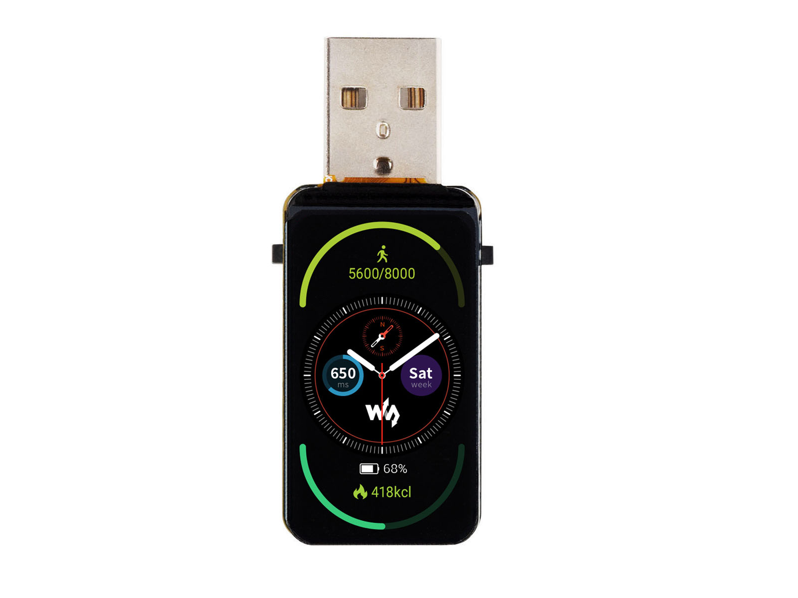

  <h1>ESP32-S3-LCD-1.47</h1>
  
<strong>ESP32-S3 1.47-inch 172 × 320 LCD development board examples and firmware</strong>

  
<strong>English</strong> | <a href="README_ZH.md">简体中文</a>

  

    
    
    
  

  

    <a href="https://www.waveshare.com/product/esp32-s3-lcd-1.47.htm">🛒 Product</a> &middot;
    <a href="https://github.com/waveshareteam/ESP32-S3-LCD-1.47/releases/latest">📦 Firmware</a> &middot;
    <a href="examples/esp-idf/">🧩 ESP-IDF</a> &middot;
    <a href="examples/arduino/examples/">🔧 Arduino</a> &middot;
    <a href="https://www.waveshare.com/wiki/ESP32-S3-LCD-1.47">📖 Documentation</a>
  

  

---

## ✨ Overview

This repository provides ESP-IDF and Arduino examples for the ESP32-S3-LCD-1.47 development board. The examples demonstrate the onboard ST7789 LCD, LVGL, TF card, RGB LED, Wi-Fi and Bluetooth features.

| Feature | Device / interface |
| --- | --- |
| MCU | ESP32-S3R8 |
| Memory | 16 MB Flash, 8 MB PSRAM |
| Display | 1.47-inch, 172 × 320, ST7789, SPI |
| Storage | Onboard TF card slot |

## 📦 Quick Start

1. Select the example and framework version you need from this repository.
2. Follow the framework-specific README in the example directory.
3. Connect the board over USB and flash the generated image with the documented command.

Factory firmware restores the out-of-box demo. Download the file whose name contains `FactoryOnly` from the [`firmware`](firmware/) folder and flash it from address `0x0`.

## 🧪 Examples

### ESP-IDF

| Example | Main feature |
| --- | --- |
| [01_lcd_demo](examples/esp-idf/01_lcd_demo/) | LCD, LVGL, TF card, RGB LED, Wi-Fi and Bluetooth |

### Arduino

| Example | Main feature |
| --- | --- |
| [01_lcd_image](examples/arduino/examples/01_lcd_image/) | Display PNG images from a TF card |
| [02_lvgl_arduino](examples/arduino/examples/02_lvgl_arduino/) | LVGL user interface with LCD and peripherals |

Libraries used by the sketches are bundled in [`examples/arduino/libraries`](examples/arduino/libraries/).

## 🛠️ Development Environment

| Framework | Version | Examples |
| --- | --- | ---: |
| ESP-IDF | `v5.5.6`, `v6.1.1` | 1 |
| Arduino-ESP32 | `4.0.0` | 2 |

## 📚 Resources

- [Product page](https://www.waveshare.com/product/esp32-s3-lcd-1.47.htm)
- [Wiki](https://www.waveshare.com/wiki/ESP32-S3-LCD-1.47)

## 🤝 Support

- Example or repository problem: [open an issue](https://github.com/waveshareteam/ESP32-S3-LCD-1.47/issues/new/choose).
- Product usage, hardware or order questions: [Waveshare support](https://service.waveshare.com/).

## 📄 License

Apache License 2.0. See [LICENSE](LICENSE).
