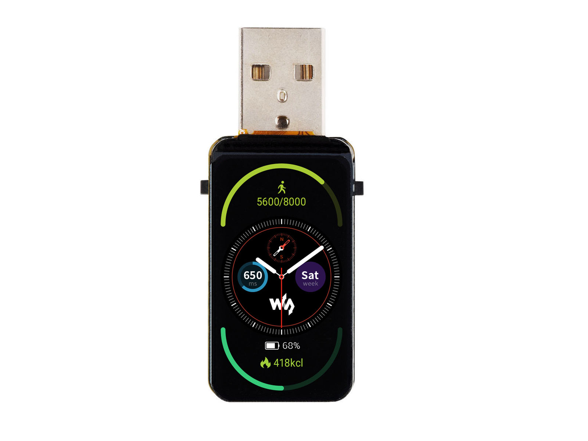

  <h1>ESP32-S3-LCD-1.47</h1>
  
<strong>ESP32-S3 1.47 英寸 172 × 320 LCD 开发板示例和固件</strong>

  
<a href="README.md">English</a> | <strong>简体中文</strong>

  

    
    
    
  

  

    <a href="https://www.waveshare.com/product/esp32-s3-lcd-1.47.htm">🛒 产品</a> &middot;
    <a href="https://github.com/waveshareteam/ESP32-S3-LCD-1.47/releases/latest">📦 固件</a> &middot;
    <a href="examples/esp-idf/">🧩 ESP-IDF</a> &middot;
    <a href="examples/arduino/examples/">🔧 Arduino</a> &middot;
    <a href="https://www.waveshare.com/wiki/ESP32-S3-LCD-1.47">📖 文档</a>
  

  

---

## ✨ 概述

本仓库提供 ESP32-S3-LCD-1.47 开发板的 ESP-IDF 和 Arduino 示例，演示板载 ST7789 LCD、LVGL、TF 卡、RGB LED、Wi-Fi 和蓝牙功能。

| 功能 | 器件或接口 |
| --- | --- |
| MCU | ESP32-S3R8 |
| 存储器 | 16 MB Flash，8 MB PSRAM |
| 显示 | 1.47 英寸、172 × 320、ST7789、SPI |
| 存储 | 板载 TF 卡槽 |

## 📦 快速开始

1. 在本仓库选择需要的示例和框架版本。
2. 按示例目录中的说明配置对应开发环境。
3. 通过 USB 连接开发板，并使用示例文档中的命令烧录生成的固件。

出厂固件可恢复开箱演示。在 [`firmware`](firmware/) 目录下载文件名带 `FactoryOnly` 的文件，从地址 `0x0` 开始烧录。

## 🧪 示例

### ESP-IDF

| 示例 | 主要功能 |
| --- | --- |
| [01_lcd_demo](examples/esp-idf/01_lcd_demo/) | LCD、LVGL、TF 卡、RGB LED、Wi-Fi 和蓝牙 |

### Arduino

| 示例 | 主要功能 |
| --- | --- |
| [01_lcd_image](examples/arduino/examples/01_lcd_image/) | 从 TF 卡显示 PNG 图片 |
| [02_lvgl_arduino](examples/arduino/examples/02_lvgl_arduino/) | 使用 LCD 和外设的 LVGL 用户界面 |

草图使用的库随仓库提供，位于 [`examples/arduino/libraries`](examples/arduino/libraries/)。

## 🛠️ 开发环境

| 开发框架 | 版本 | 示例数 |
| --- | --- | ---: |
| ESP-IDF | `v5.5.6`、`v6.1.1` | 1 |
| Arduino-ESP32 | `4.0.0` | 2 |

## 📚 资料

- [产品页](https://www.waveshare.com/product/esp32-s3-lcd-1.47.htm)
- [Wiki](https://www.waveshare.com/wiki/ESP32-S3-LCD-1.47)

## 🤝 支持

- 示例或仓库问题：[提交 issue](https://gitee.com/waveshare/ESP32-S3-LCD-1.47/issues)。
- 产品使用、硬件或订单问题：[微雪技术支持](https://service.waveshare.com/)。

## 📄 许可证

Apache License 2.0，详见 [LICENSE](LICENSE)。
